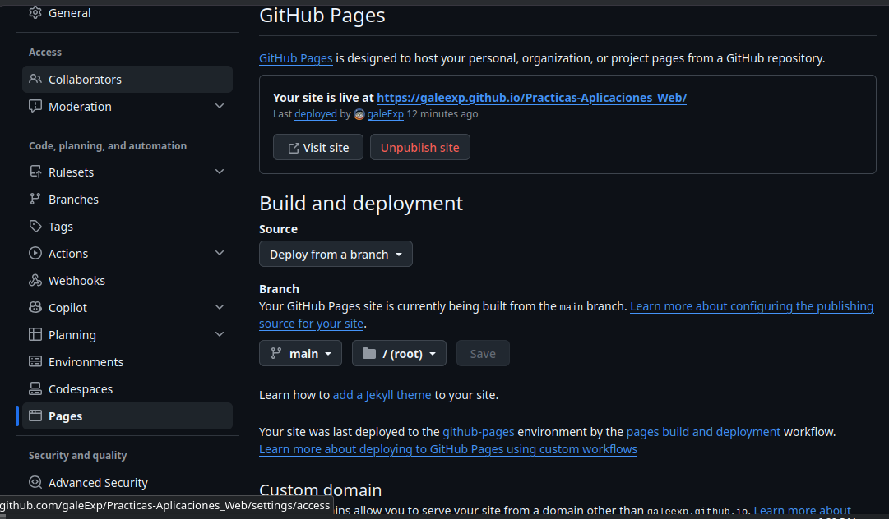

# Prácticas de la Asignatura  de Aplicaciones web 
## Docente:M.T.I Marco A. Ramírez Hernández 
#### Carrera:T.S.U En Desarrollo de Software Multiplataforma
Periodo: Septiembre - Diciembre 2026
---
### Tabla de Prácticas de la Materia

|no.|Nombre|Descripción|Potenciador|Estatus|
|:-|:-|:-|:-:|:-:|
|1. |Metodología de Evaluación de la Materia |Transcribir a libreta y comprender la metodología de evaluación de la asignatura |5 |🟢Concluida|
|2.|Mi Primer Página Web|Codificar la primer págiona web con HTML puro, sin estilos ni funcionalidades|10|🟢 Concluida|
||

### 🌐 GitHub Pages

🔗 https://galeexp.github.io/Practicas-Aplicaciones_Web/

---

### Configuración en GitHub
1. Terminé mi práctica en la rama `Practica03` y la subí a GitHub.
2. Uní `Practica03` a `main` con un commit de merge, para conservar el historial.
3. Renombré la página principal a `index.html`, porque GitHub Pages usa ese archivo como página de inicio.
4. En el repositorio entré a **Settings → Pages**.
5. En **Build and deployment → Source** elegí **Deploy from a branch**.
6. En **Branch** seleccioné `main` y la carpeta `/ (root)`, y presioné **Save**.
7. Esperé unos minutos hasta que GitHub mostró el mensaje *"Your site is live at…"* con la URL.
8. Abrí el sitio con **Visit site** y comprobé que cargara correctamente.

A partir de entonces, cada `git push` a `main` actualiza el sitio automáticamente.




---


#### Comandos usados

```bash
# Unir la rama a main (con commit de merge)
git checkout main
git pull origin main
git merge --no-ff Practica03 -m "Merge branch 'Practica03'"
git push origin main

# Renombrar la página principal
git mv MiPerfil.html index.html
git commit -m "Renombrar a index.html"
git push origin main

# Eliminar la rama (local y remota)
git branch -d Practica03
git push origin --delete Practica03
```
#### Dificultades
| Dificultad | Solución |
|---|---|
| Al hacer un merge normal, Git hizo *fast-forward* y no dejó commit de unión, por lo que el gráfico se veía como una sola línea. | Usé `git merge --no-ff` para crear el commit de merge, como en la Práctica 02. |
| Git distingue mayúsculas y minúsculas: la rama es `Practica03`, no `practica03`, y los comandos fallaban. | Escribí el nombre exacto de la rama, con la P mayúscula. |
| GitHub Pages necesita un archivo `index.html` para mostrar la página en la URL raíz; mi archivo se llamaba `MiPerfil.html`. | Lo renombré a `index.html` con `git mv`. |
| Los cambios no aparecían de inmediato después del `push`. | Esperé 1 a 3 minutos a que terminara el despliegue (workflow *pages build and deployment*) y recargué la página. |
| Después del merge quedó la rama `Practica03` sobrando. | La eliminé local y remotamente para dejar el repositorio limpio solo con `main`. |

#### Conclusion
GitHub Pages permite publicar un sitio estático directamente desde el repositorio, sin servidores ni costo. Con este reto practiqué el trabajo con ramas, el despliegue web y la documentación de un proceso técnico.

Activación: **Settings → Pages → Deploy from a branch → `main` / `(root)` → Save**.

